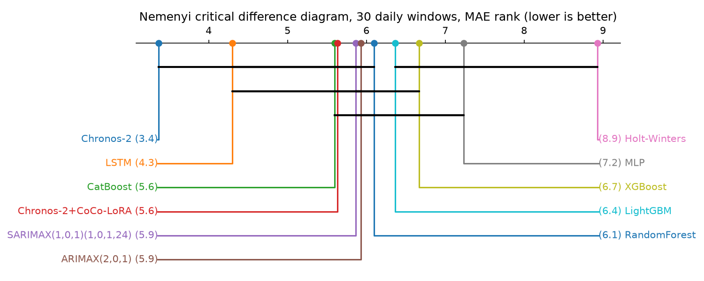
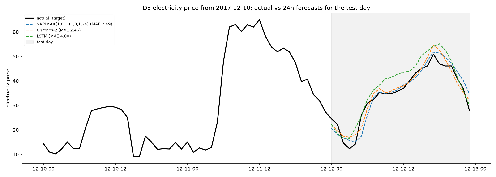

# chronos_llm

Benchmark of Amazon Chronos-2 (zero-shot) against classical, ML and deep-learning baselines on the
AutoGluon `electricity_price` dataset (DE hourly prices, 2 covariates: load forecast and PV+wind forecast).

## Setup

```sh
uv sync
```

Data lives in `data/` (train/test parquet from the AutoGluon S3 bucket).

## Scripts

| file | what it does |
|---|---|
| `index.py` | Single 24h forecast of the test day with Chronos-2 + the SWARM-Lab CoCo LoRA adapter |
| `compare.py` | 30-day rolling backtest of all models, Friedman/Nemenyi test, `nemenyi.png`, `forecast.png` |
| `windows.py` | Shared backtest window definition (`N_WIN` days, 24h each, test day is the last window) |
| `chronos_pred.py` | Chronos-2 forecasts for every window, cached to `data/chronos_pred.parquet` |
| `chronos_lora_pred.py` | Same, with the CoCo LoRA adapter merged in |
| `lstm_pred.py` | LSTM (168h encoder + future covariates), trained on the year before the backtest |

```sh
uv run python compare.py
```

Torch models run in their own process because torch + xgboost/lightgbm/catboost in one process segfaults on
macOS (duplicate libomp). Their forecasts are cached in `data/*_pred.parquet`; delete a cache to recompute.

## Models

- Chronos-2 zero-shot, with and without CoCo LoRA
- ARIMAX(2,0,1), SARIMAX(1,0,1)(1,0,1,24), Holt-Winters: refit per window on the last 4 weeks
- RandomForest, XGBoost, LightGBM, CatBoost, MLP: fit once on all data before the backtest,
  features = covariates + hour + weekday + lag24 + lag168
- LSTM: trained once on the last year before the backtest

## Results (30 daily windows, 24h ahead)

| model | MAE | RMSE | mean rank | Nemenyi p vs best |
|---|---|---|---|---|
| Chronos-2 | 4.83 | 6.74 | 3.37 | |
| LSTM | 5.50 | 7.85 | 4.30 | 0.992 |
| CatBoost | 6.82 | 9.24 | 5.60 | 0.244 |
| Chronos-2 + CoCo LoRA | 6.73 | 9.78 | 5.63 | 0.225 |
| SARIMAX | 6.52 | 8.65 | 5.87 | 0.117 |
| ARIMAX | 6.54 | 8.49 | 5.93 | 0.095 |
| RandomForest | 6.89 | 9.46 | 6.10 | 0.054 |
| LightGBM | 6.95 | 9.30 | 6.37 | 0.020 |
| XGBoost | 7.11 | 9.48 | 6.67 | 0.006 |
| MLP | 7.71 | 10.52 | 7.23 | 0.000 |
| Holt-Winters | 10.76 | 14.36 | 8.93 | 0.000 |

Friedman chi2 = 56.9, p = 1.4e-8. Chronos-2 is significantly better than LightGBM, XGBoost, MLP and
Holt-Winters (alpha = 0.05) and statistically tied with the rest. The CoCo LoRA adapter hurts here: it was
trained to consume LLM forecast/confidence covariates, which this dataset does not provide.




